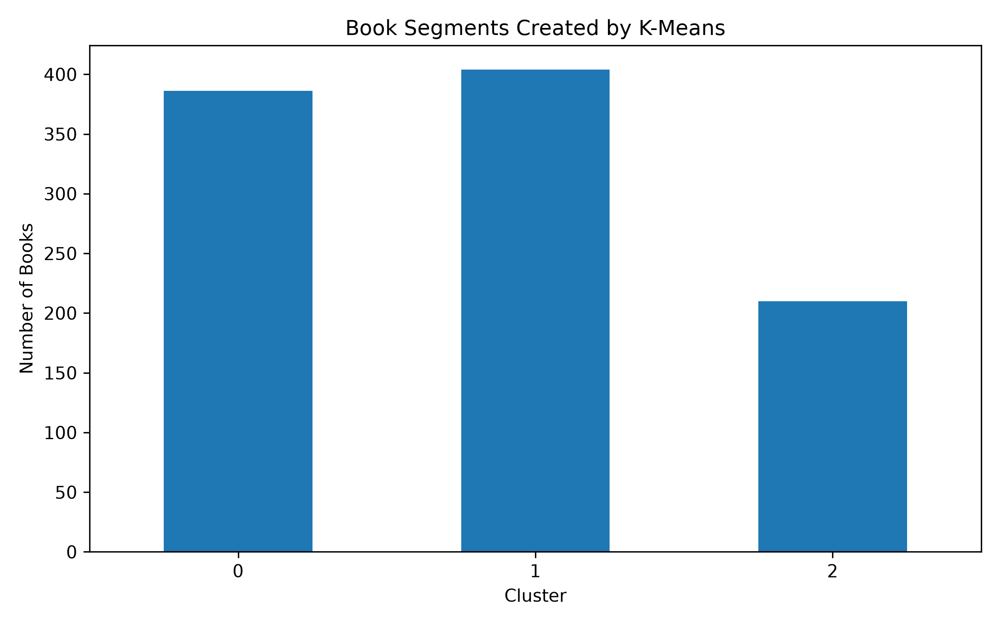
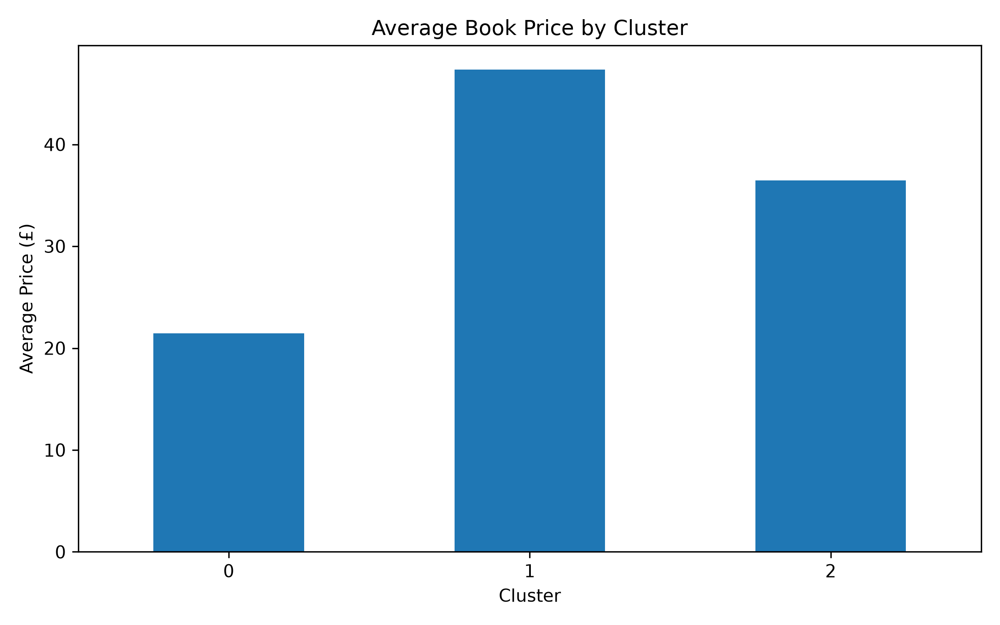
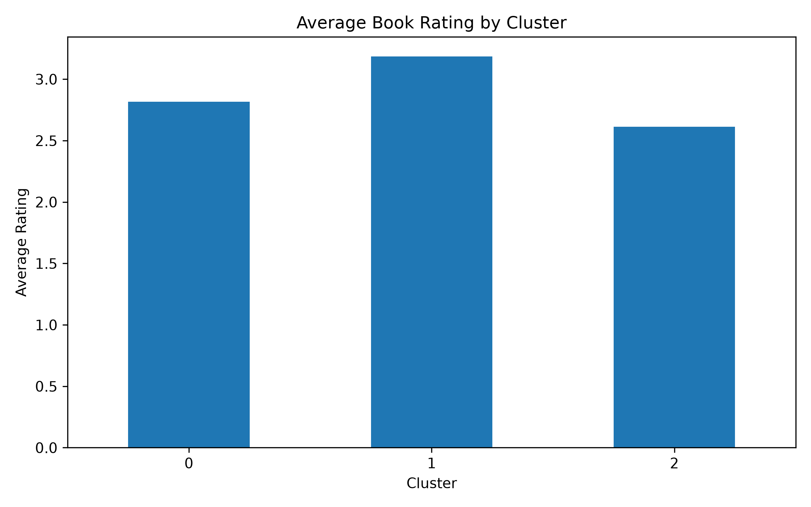
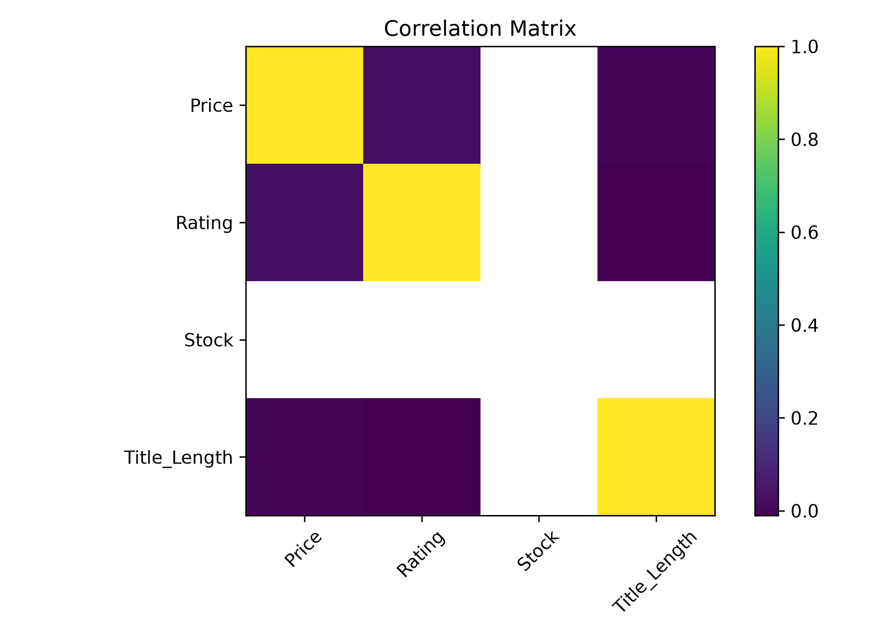
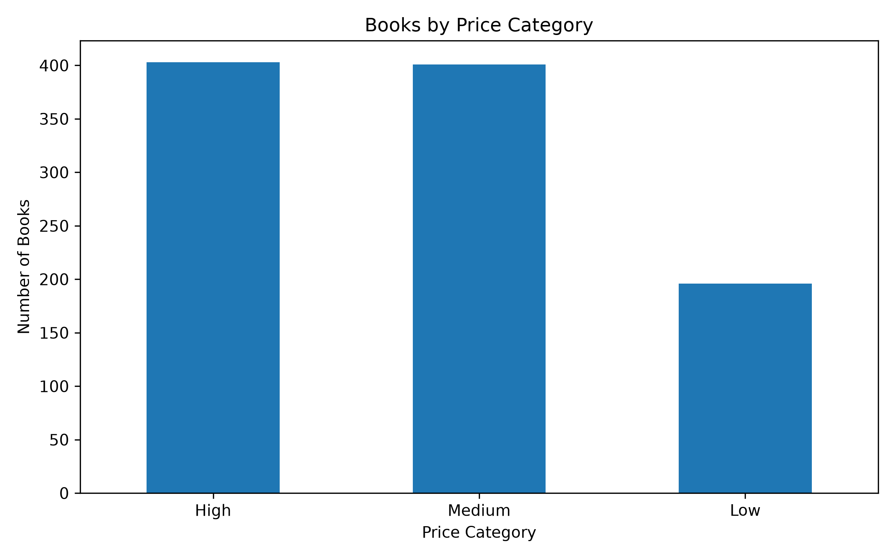
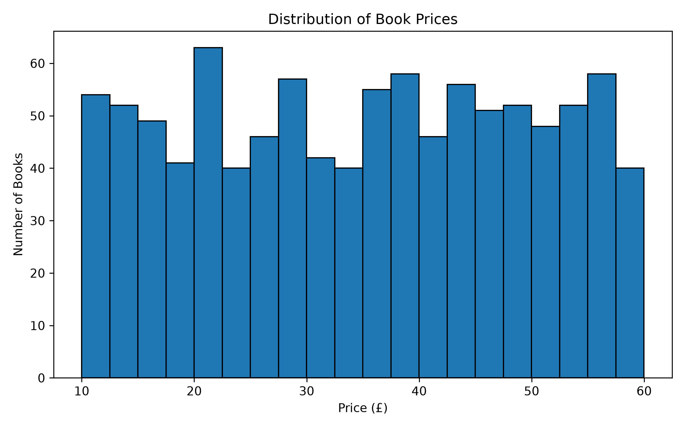
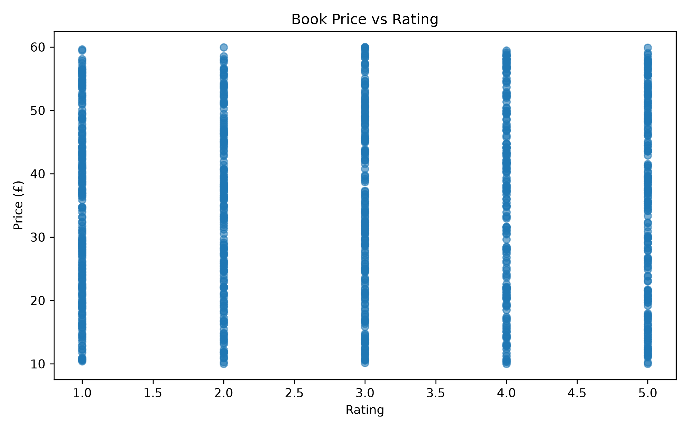
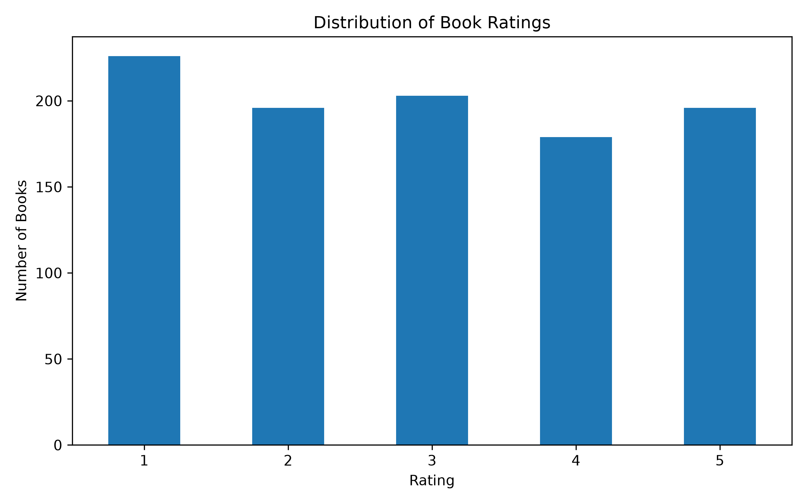

# Market Basket Analysis with Python

## 📌 Project Overview
This project analyzes e-commerce data to identify customer purchasing patterns and behavioral trends. The analysis aims to discover product bundling opportunities and support data-driven marketing decisions.

## 🛠️ Tools & Technologies
- Python
- Pandas
- NumPy
- Scikit-learn

## 🎯 Objectives
- Identify customer purchasing patterns.
- Explore product recommendations and bundling opportunities.
- Generate insights to support marketing strategies.

## 📊 Project Structure
- `src/` — Python source code.
- `data/` — Dataset files, if shareable.
- `images/` — Project screenshots and visualizations.

## 🔍 Key Findings
Key findings and visualizations will be added after the analysis files are uploaded.

## 📊 Project Visualizations

### 1. Cluster Distribution

### 2. Cluster Price Analysis

### 3. Cluster Rating Analysis

### 4. Correlation Matrix

### 5. Price Category Analysis

### 6. Price Distribution

### 7. Price vs. Rating

### 8. Rating Distribution

